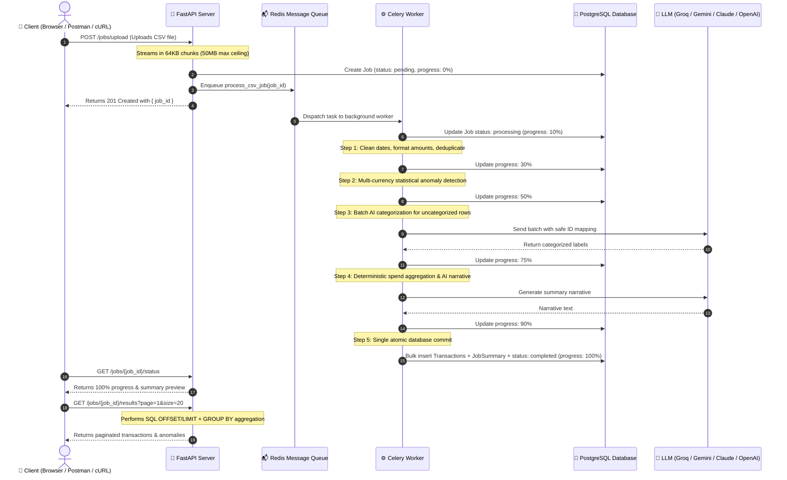

# ⚡ Raijin: AI-Powered Financial Transaction Processing Engine

[](https://github.com/Spidey173/Raijin/actions/workflows/ci.yml)
[](https://fastapi.tiangolo.com)
[](https://docs.celeryq.dev)
[](https://www.postgresql.org)
[](https://redis.io)
[](https://www.python.org)

**Raijin** is a production-grade, asynchronous backend system that processes bank and credit card CSV statements. It ingests transaction files, cleans and deduplicates messy financial data, detects suspicious fraudulent anomalies, uses AI models to automatically categorize unlabeled expenses, and calculates executive spend analytics—all without blocking user requests.

---

## 🌟 What Problem Does Raijin Solve? (For Beginners)

When you download bank or credit card statements, you often face real-world data problems:
1. **Messy & Duplicate Rows:** Different date formats (`04-09-2024` vs `2024/02/05`), currency symbols (`$`, `₹`), comma-formatted amounts (`10,882.55`), and accidental duplicate charges.
2. **Missing Categories:** Statements often leave merchants uncategorized (e.g. `Swiggy` or `Uber` has no category).
3. **Suspicious Activity & Fraud:** Unusually large spikes (e.g. spending ₹1.9 lakh on a train ticket) or domestic Indian services billing in foreign currencies (USD).
4. **Performance Freezes:** Uploading 50,000 transactions at once would crash or freeze a standard web server if processed synchronously.

**Raijin solves this completely:** It accepts the upload in milliseconds, hands the heavy processing to an asynchronous **Celery worker** queue, runs statistical anomaly checks, uses an LLM to categorize transactions, and persists the clean results into **PostgreSQL**.

---

## 🏛️ System Architecture



---

## 🧩 Key Concepts Explained Simply

| Concept | What It Does In Raijin |
| :--- | :--- |
| **FastAPI** | High-performance Python web framework that validates requests, handles file uploads, and serves the REST API. |
| **Celery** | Asynchronous task queue that processes CSV files in the background so your web server stays fast and responsive. |
| **Redis** | In-memory message broker that holds pending tasks until Celery workers pick them up. |
| **PostgreSQL** | Production relational database that stores jobs, cleaned transactions, and spend summaries. |
| **Alembic** | Version-controlled database migration tool that automatically creates and updates database tables. |
| **Multi-Provider LLM** | Connects to **Groq**, **Google Gemini**, **Anthropic Claude**, or **OpenAI** to categorize unlabeled expenses. If no API key is provided, an internal mock engine runs so everything works out of the box! |
| **Multi-Currency Medians** | Calculates median spend per account *and* per currency, preventing USD charges from skewing INR statistics. |
| **Tenant Ownership** | Binds jobs to user identities (`X-User-ID`), ensuring users can only view and manage their own financial data. |

---

## ⚡ Quickstart: Run in 3 Minutes with Docker

The easiest way to run Raijin is with **Docker Compose**, which starts the API, Worker, Database, and Redis automatically.

### Step 1: Clone the Repository
```bash
git clone https://github.com/Spidey173/Raijin.git
cd Raijin
```

### Step 2: Configure Environment Variables
Copy `.env.example` to `.env`:
```bash
cp .env.example .env
```

*(Optional)* If you have an LLM API key, add it to `.env`:
```env
LLM_PROVIDER=groq
GROQ_API_KEY=gsk_your_key_here
GROQ_MODEL=qwen/qwen3.8-27b
```
> **Tip for Freshers:** Don't have an API key? No problem! Leave it as default—Raijin includes an automated fallback mock generator, so the entire pipeline runs without any paid keys or external setup.

### Step 3: Launch Services
```bash
docker compose up --build
```
Once started, the API is live at **[http://localhost:8000](http://localhost:8000)**.
- **Interactive Swagger Documentation:** [http://localhost:8000/docs](http://localhost:8000/docs)
- **ReDoc Documentation:** [http://localhost:8000/redoc](http://localhost:8000/redoc)

---

## 🛠️ Alternative: Run Locally (Without Docker)

For learning, development, or running unit tests on your machine:

```bash
# 1. Create and activate a virtual environment
python3 -m venv .venv
source .venv/bin/activate  # On Windows: .venv\Scripts\activate

# 2. Install dependencies
pip install -r requirements.txt

# 3. Set up environment
cp .env.example .env

# 4. Run tests
pytest -v

# 5. Start the API server
uvicorn app.main:app --host 0.0.0.0 --port 8000 --reload
```

---

## 📖 Step-by-Step API Walkthrough

Here is how to test the pipeline using `curl` or [Swagger UI](http://localhost:8000/docs).

### 1. Upload a CSV Statement
Raijin includes a ready-to-test sample statement: [`transactions.csv`](file:///Users/spidey./Downloads/Spidey/Raijin/transactions.csv).

```bash
curl -X POST "http://localhost:8000/jobs/upload" \
  -H "X-User-ID: john_doe" \
  -F "file=@transactions.csv"
```
**Response:**
```json
{
  "job_id": "bc14f44e-71e3-4e09-9d6e-c833ef8e6be8"
}
```

---

### 2. Check Job Progress & Status
Track your job in real-time as it advances through progress stages (`10%` -> `30%` -> `50%` -> `75%` -> `90%` -> `100%`):

```bash
curl "http://localhost:8000/jobs/bc14f44e-71e3-4e09-9d6e-c833ef8e6be8/status" \
  -H "X-User-ID: john_doe"
```
**Response (When Completed):**
```json
{
  "job_id": "bc14f44e-71e3-4e09-9d6e-c833ef8e6be8",
  "owner_id": "john_doe",
  "status": "completed",
  "progress": "100%",
  "created_at": "2026-10-29T21:18:39.000000+00:00",
  "completed_at": "2026-10-29T21:18:39.105000+00:00",
  "row_count_raw": 95,
  "row_count_clean": 85,
  "error_message": null,
  "summary": {
    "row_count_raw": 95,
    "row_count_clean": 85,
    "total_spend_inr": 1156774.05,
    "total_spend_usd": 39846.98,
    "anomaly_count": 10,
    "risk_level": "medium"
  }
}
```

---

### 3. Retrieve Cleaned Results (Database-Level Pagination)
Results are paginated directly at the database engine so large datasets load instantaneously:

```bash
curl "http://localhost:8000/jobs/bc14f44e-71e3-4e09-9d6e-c833ef8e6be8/results?page=1&size=5" \
  -H "X-User-ID: john_doe"
```
**Response Preview:**
```json
{
  "job_id": "bc14f44e-71e3-4e09-9d6e-c833ef8e6be8",
  "status": "completed",
  "total_cleaned": 85,
  "total_anomalies": 10,
  "category_breakdown": {
    "Food": { "total_amount": 76540.20, "transaction_count": 12 },
    "Shopping": { "total_amount": 204555.77, "transaction_count": 19 },
    "Travel": { "total_amount": 424807.55, "transaction_count": 22 },
    "Utilities": { "total_amount": 248597.18, "transaction_count": 14 }
  },
  "summary": {
    "total_spend_inr": 1156774.05,
    "total_spend_usd": 39846.98,
    "anomaly_count": 10,
    "risk_level": "medium",
    "top_merchants": [
      { "merchant": "IRCTC", "spend": 424807.55, "currency": "INR" },
      { "merchant": "Jio Recharge", "spend": 248597.18, "currency": "INR" },
      { "merchant": "Flipkart", "spend": 204555.77, "currency": "INR" }
    ],
    "narrative": "Automated financial report: Transaction patterns reflect regular operational and personal expenses with expected distribution across domestic merchants."
  },
  "cleaned_transactions": [ ... ],
  "anomalies": [ ... ]
}
```

---

### 4. Retry a Failed Job
If a network blip or API timeout interrupted a job, you can retry it without re-uploading the file:

```bash
curl -X POST "http://localhost:8000/jobs/bc14f44e-71e3-4e09-9d6e-c833ef8e6be8/retry" \
  -H "X-User-ID: john_doe"
```

---

### 5. List All Jobs (With Tenant Isolation)
Users only see jobs they own:

```bash
curl "http://localhost:8000/jobs?status=completed&page=1&size=10" \
  -H "X-User-ID: john_doe"
```

---

## 🔍 Anomaly Detection Rules Explained

Raijin evaluates every transaction against statistical and domain rules:

1. **Rule 1 (Statistical 3x Median Outlier):**
   - Groups transactions strictly by `(account_id, currency)`.
   - Computes the median transaction amount for each account and currency.
   - If a charge exceeds $3 \times \text{median}$, it is flagged (e.g. ₹1,93,647 IRCTC booking vs median ₹9,547).
2. **Rule 2 (Domestic Service USD Abuse):**
   - Purely domestic Indian consumer merchants (`Zomato`, `Swiggy`, `Ola`, `IRCTC`, `Flipkart`, `Blinkit`, `Zepto`, `Jio`) should never bill domestic consumers in foreign currencies.
   - Any transaction for these merchants billed in `USD` is automatically flagged as suspicious.

---

## 📂 Project Directory Structure

```text
Raijin/
├── .github/
│   └── workflows/
│       └── ci.yml               # Automated CI pipeline (Python 3.11 & 3.12)
├── app/
│   ├── auth.py                  # User/tenant identity resolution & ownership checks
│   ├── celery_app.py            # Celery worker initialization & configuration
│   ├── config.py                # Environment settings & directory validation
│   ├── database.py              # SQLAlchemy engine, connection pooling & SessionLocal
│   ├── main.py                  # FastAPI application entrypoint & CORS middleware
│   ├── tasks.py                 # Background Celery task with atomic persistence
│   ├── models/                  # SQLAlchemy ORM database models
│   │   ├── job.py               # Job table with progress & owner_id
│   │   ├── transaction.py       # Transactions table with anomaly columns & indexes
│   │   └── summary.py           # Job summaries table with JSON top merchants
│   ├── schemas/                 # Pydantic validation & response schemas
│   │   ├── job.py               # Job request & response models
│   │   ├── transaction.py       # Transaction serialization models
│   │   └── summary.py           # Summary response models
│   ├── services/                # Business logic engines
│   │   ├── cleaning.py          # CSV parsing, date normalization, deduplication
│   │   ├── anomaly.py           # Multi-currency statistical & domestic anomaly rules
│   │   └── llm.py               # Multi-provider AI classification & executive narrative
│   └── routers/
│       └── jobs.py              # REST API endpoints (upload, status, results, retry)
├── migrations/                  # Alembic database migration scripts
│   ├── versions/                # Versioned migration files (001, 002, 003)
│   └── env.py                   # Migration environment setup
├── tests/                       # Automated test suite (27 unit & integration tests)
│   ├── conftest.py              # Pytest fixtures & in-memory SQLite setup
│   ├── test_api.py              # API endpoint, ownership, & end-to-end tests
│   ├── test_cleaning.py         # CSV parsing & deduplication tests
│   ├── test_anomaly.py          # Statistical & multi-currency anomaly tests
│   └── test_llm.py              # LLM prompt, retry, & provider selection tests
├── docker-compose.yml           # Multi-container orchestration (API, Worker, DB, Redis)
├── Dockerfile                   # Production Python 3.12 container specification
├── requirements.txt             # Pinned production Python dependencies
├── transactions.csv             # 95-row sample financial statement for testing
└── README.md                    # Project documentation
```

---

## 🧪 Running Automated Tests

Run the full automated test suite (includes unit, integration, and end-to-end pipeline execution):

```bash
pytest -v
```
Expected output:
```text
============================== 27 passed in 0.14s ==============================
```

---

## ❓ Frequently Asked Questions (FAQ)

### 1. Do I need an OpenAI or Groq API key to run this?
**No.** Raijin includes a built-in mock response engine. If no API key is provided in `.env`, it automatically generates valid mock categories and financial narratives. You can run and test 100% of the project without entering any credentials.

### 2. Can I upload large CSV statements?
**Yes.** File uploads stream directly in 64 KB chunks up to a 50 MB ceiling, preventing memory spikes. Results are paginated with SQL `OFFSET` and `LIMIT` so multi-thousand transaction jobs query seamlessly.

### 3. What happens if a job fails halfway through?
Raijin uses **atomic database transactions**. If summary generation or network communication fails, the transaction is cleanly rolled back—no orphaned rows remain in the database. You can retry the job anytime via `POST /jobs/{id}/retry`.

---

## 📄 License
This project is open-source and available under the [MIT License](LICENSE).
